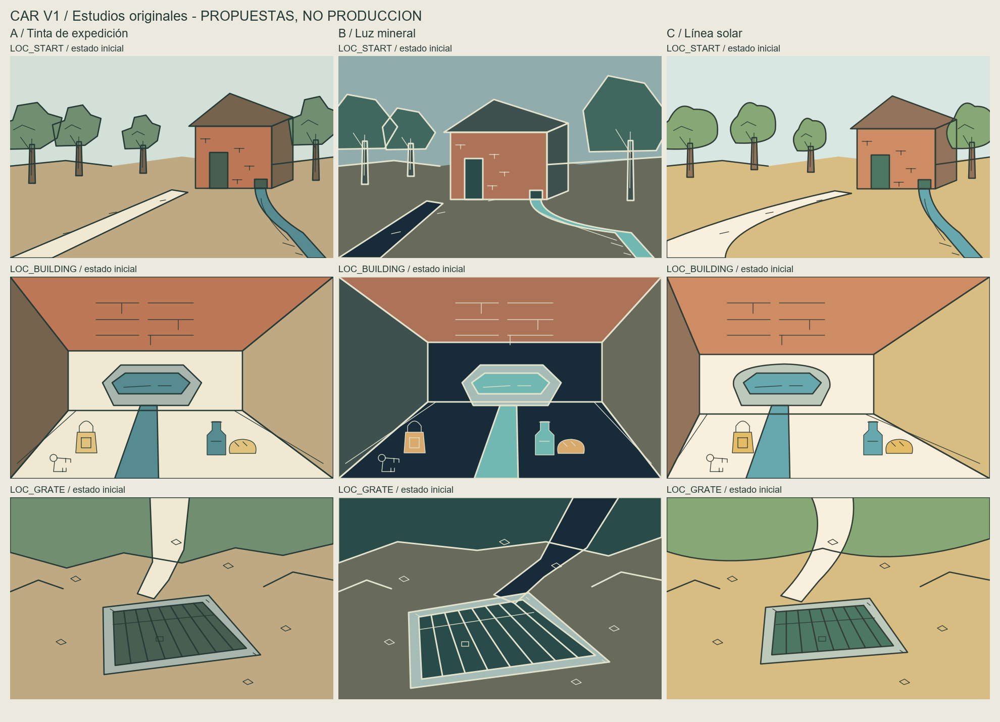

# CAR-ART-001 — Vector Art Direction & Drawing Experience Gate

Estado: **CLOSED / DECISION RECORDED**. Resultado documental: la investigación quedó revisada y la dirección artística fue seleccionada por decisión humana. La viabilidad técnica y la reproducción gráfica del visor siguen pendientes; esto no es una implementación productiva.

Rol: Jack Burton, dirección creativa. Conceptos originales preparados con asistencia de Codex; el rol no atribuye autoría o aceptación a un artista humano. Fecha: 2026-10-25. Baseline: `2dfaa96bc6af7ab2ed8f6aab24e33c45b183acaf`, `main`, árbol/índice inicialmente limpios; cinco commits por delante de la referencia local `origin/main` (`b562386…`). No se consultó el remoto en vivo.

## Material de revisión

- [Nueve estudios comparables](studies/comparison.png), tres tratamientos × START/BUILDING/GRATE; [lámina vectorial](studies/comparison.svg).
- [Storyboard LINE/FILL](studies/sequence.png): cuatro viñetas estáticas, no mediciones de duración. Fuentes `sequence_1.svg`–`sequence_4.svg`.
- [Visor conceptual autocontenido](studies/review.html), para abrir localmente en navegador: selección, reproducción, pausa, omisión, duración, aceleración, comandos completos/interpolados y relleno instantáneo/progresivo.
- [Captura actual de CH_01](studies/audit_renderer.png) y [evidencia técnica](studies/audit_evidence.json).
- [Generador reproducible](studies/build_studies.py). Ningún archivo del estudio es consumido por el juego.

## 1. Brief aprobado y propuestas

El encargo humano fija CAR V1 como aventura vectorial contemporánea con contornos progresivos y rellenos posteriores. Recuperar la sensación de las primeras aventuras ilustradas no obliga a conservar sus restricciones técnicas. Pixel art moderno, pintura digital, música y una reinterpretación narrativa más elaborada quedan fuera de CAR V1 y reservados como posibilidades para una futura V2.

### Decisión humana — 2026-10-25

El responsable selecciona **C — Línea solar** para CAR V1. La decisión se basa en su luminosidad, legibilidad, curvas suaves y continuidad con el espíritu vectorial de las primeras aventuras. Los estudios `C_LOC_START.svg`, `C_LOC_BUILDING.svg` y `C_LOC_GRATE.svg`, incluidos en [la lámina comparativa](studies/comparison.png), son referencias conceptuales para esta dirección; no son assets finales ni se incorporan al juego.

Quedan aprobados como **objetivos de prototipo para CAR-ART-002**, no como resultados técnicos verificados ni como contrato implementado:

- Secuencia completa de objetivo: **3,5 segundos**, referencia **1×**.
- Contornos interpolados por longitud, con avance visible real.
- Relleno progresivo por región con propagación espacial perceptible.
- Omitir la secuencia debe producir el mismo resultado final que reproducirla completa.
- El parser debe seguir utilizable durante la reproducción; las visitas repetidas no impondrán esperas obligatorias.

La decisión estética C queda registrada y cierra este gate. No demuestra que el renderer actual pueda cumplir los objetivos temporales o de relleno; esa viabilidad requiere un prototipo técnico aislado. Los hallazgos, incertidumbres y limitaciones originales de la auditoría se conservan abajo y en los estudios.

## 2. Diagnóstico verificado del flujo actual

Referencias:

- [room_illustration.gd](../../../07_godot_open_adventure/godot/src/render/room_illustration.gd): `from_dict()` (16), `render()` (38), `render_image()` (43), `_draw_line()` (70), `_fill_region()` (97), `_find_free_cell()` (131).
- [illustration_view.gd](../../../07_godot_open_adventure/godot/src/ui/illustration_view.gd): `show_room()` (16), `_draw()` (36).
- [main.gd](../../../07_godot_open_adventure/godot/src/ui/main.gd): `_on_command()` (129), `_refresh_status()` (172).
- [Datos de arte](../../../07_godot_open_adventure/godot/data/art_ch01.json), [captura de escenas](../../../07_godot_open_adventure/godot/tools/capture_scenes.gd) y [configuración](../../../07_godot_open_adventure/godot/project.godot).

**Renderer:** rasteriza todas las líneas y luego todos los flood fills en una llamada síncrona; devuelve una textura terminada. No expone progreso, cursor temporal o frames intermedios. El fill usa una pila, vecinos ortogonales y máscara global de tinta.

**Presentación:** `show_room()` llama a `render()` y guarda la textura final; `_draw()` solo la escala conservando aspecto. `_refresh_status()` vuelve a llamar a `show_room()` tras órdenes sin movimiento. Una reproducción nueva necesitaría distinguir sala, estado visual y visita para no reiniciarse con cada refresh. Al ocultar la vista con Tab también necesitaría política de pausa/cancelación.

**Conclusión observada:** la falta de progresividad procede de ambos. No existe reproducción temporal de los comandos actuales. Un fundido de la imagen completa no muestra el recorrido del contorno.

**Resolución:** las escenas no declaran `grid`; `from_dict()` usa el valor por defecto 64 × 40. El caller transmite `meta.palette`, pero no `meta.grid`: cambiar solo este último no cambia la cuadrícula efectiva. La captura también fija 64 × 40. Una ventana 1920 × 1080 no añade geometría a la fuente.

**Estado visual:** solo se pasa ID de sala/arte estático. No hay variantes por objetos recogidos o reja abierta; los IDs FOREST se remiten a la misma ilustración. Es un límite observado, no autorización para cambiarlo.

## 3. Auditoría de los once dibujos

Inspección visual de `captures/scenes.png` y `captures/main.png`. La segunda conserva título/composición de interfaz antiguos: no acredita la UI actual. Para verificar el arte, se copiaron renderer y JSON **sin editar** a un proyecto temporal: Godot 4.7.2 produjo una hoja idéntica byte a byte a la rastreada. Huellas y orden en `audit_evidence.json`.

Juicio artístico: comunican símbolos básicos, pero la profundidad, jerarquía y materia son débiles. Hay 6–15 polilíneas, 17–39 segmentos y 4–13 rellenos por escena. Más comandos no resolverían por sí solos composición o ritmo.

| Dibujo | LINE/FILL | Conservar | Rediseño propuesto / contraste con fuente |
| --- | --- | --- | --- |
| BUILDING | 8/5 | Agua como foco | Rectángulo azul poco identificable como interior de casa de pozo. Dar planos y manantial. Los objetos iniciales no se distinguen; deben reflejar estado. |
| CLIFF | 9/8 | Abismo entre masas | Bloques simétricos comprimen altura; profundizar sin sugerir un camino descendente. La urna de CLIFF no se reconoce en el dibujo. |
| FOREST | 12/10 | Siluetas de bosque | Copas triangulares invertidas y repetidas parecen señales. Variar escala, solapes y distancia sin inventar hitos que resuelvan el laberinto. |
| GRATE | 14/5 | Barras contra hueco oscuro | Parece verja vertical; en fuente está encastrada en tierra/hormigón en depresión con cauce seco. Mostrar plano horizontal y estado. |
| HILL | 8/9 | Edificio lejano | Verde continuo aplana la pendiente. Marcar lomo y carretera que sube/baja, sin añadir conexiones. |
| LEDGE | 7/7 | Cornisa y abismo | Cornisa diminuta sin primer plano; reforzar roca y claro opuesto. El zafiro no se identifica en el arte estático. |
| ROADEND | 11/11 | Camino terminado | Jerarquizar el extremo entre árboles; evitar que un hueco negro parezca nueva entrada. |
| SEWER | 6/4 | Agua/hormigón | Parece un portal único rectangular; la fuente dice dos tuberías de un pie. Aclarar par y escala, sin sugerir paso humano. |
| SLIT | 7/5 | Agua que converge | La abertura puede parecer una puerta. En fuente son dos pulgadas: roca y agua deben dar escala; lecho seco posterior. |
| START | 15/13 | Casa, bosque, camino, arroyo | Mejor anclaje del pack. Separar puerta y salida del agua; tres cuartos y diagonales para profundidad. |
| VALLEY | 10/7 | Continuidad de las orillas | Canal uniforme y árboles seriados aplanan valle. Añadir lecho rocoso y cambios de anchura sin inventar puentes o pasos. |

La paleta tiene 19 colores nominales; las familias de tierra, ladrillo, agua y acero merecen conservarse. Tinta y relleno próximos en valor debilitan contornos; grandes campos planos dominan. Proponer mejores masas y solapes antes de añadir colores.

Fuente de contraste: [YAML](../../../06_reconstruccion_drawio/Open_Adventure.yaml), locations 382–510, SEWER 1432, LEDGE 2648; colocaciones de objetos en YAML y dataset derivado. Tejado, pila, pan y vegetación de los estudios son interpretaciones visuales, no hechos históricos. La cámara no codifica las direcciones del parser.

## 4. Referencias históricas y procedencia

Consultadas el 2026-10-25:

- [Catálogo Hi-Res Adventure, Sierra Gamers](https://www.sierragamers.com/hi-res/), archivo de Ken/Roberta Williams ([presentación](https://www.sierragamers.com/about-us/)). Sirve de contexto de la familia, no de prueba de algoritmos o duración.
- Artefacto primario visual: captura de *Mystery House*, On-Line Systems (1980), preservada en [HistoryLink](https://www.historylink.org/Content/Media/Photos/Large/Mystery-House-On-line-Systems-1980-screenshot.jpg). Inspeccionada: contorno claro/negro, arquitectura con pocas líneas, espacio negativo y texto separado. No se estableció la edición/emulación exacta.
- Artefacto primario visual: captura de *The Wizard and the Princess*, On-Line Systems (1980), preservada [aquí](https://www.myabandonware.com/media/screenshots/h/hi-res-adventure-2-the-wizard-and-the-princess-10qc/hi-res-adventure-2-the-wizard-and-the-princess_4.png). Inspeccionada: regiones delimitadas, profundidad por escalas y abismo, trama y texto inferior. No generalizar su apariencia a todas las plataformas.

**Lectura expresiva propuesta:** contornos que construyen el lugar, masas cromáticas discretas, una vista por situación y foco útil a exploración. Podemos abandonar escalones de píxel, artefactos de color, dithering obligatorio y esperas de hardware. No se midió reproducción histórica: los tiempos de CAR son propuestas UX, no reconstrucción de una velocidad común de Sierra.

Las capturas históricas solo se descargaron a una carpeta temporal; no se redistribuyen ni se presume licencia por estar online o llamarse “abandonware”. No se copiaron su mansión, puente, escenas, personajes ni trazados.

Los SVG son paths originales del generador, sin recursos remotos. Godot los rasterizó y Pillow instalado rotuló el PNG con Arial del sistema; no se distribuye el archivo de fuente. No se instaló una dependencia ni se añadió una al juego.

## 5. Tratamientos comparables

Lienzo de estudio 640 × 400, aspecto 8:5 del arte actual; no es resolución productiva aprobada. A/C comparten jerarquía para comparar; C cambia curvas/siluetas y camino/pila. B cambia escala, cámara y peso de masas.

| Propuesta | Lenguaje | Ventaja | Coste/riesgo relativo |
| --- | --- | --- | --- |
| A — Tinta de expedición | Tinta oscura, base clara, follaje angular irregular, ladrillo terroso/agua apagada, tres cuartos | Contorno visible antes/después del fill; profundidad austera | Medio: topología/solapes; puede parecer un mapa si se abusa de marcos o trama. |
| B — Luz mineral | Marfil sobre campos fríos oscuros, facetas y motivos más próximos | Alto contraste y atmósfera | Medio/alto: puede sugerir oscuridad donde fuente dice LIT. No justificar iluminación con la lámpara apagada. |
| C — Línea solar | Base cálida, verdes vivos y curvas suaves | Accesible, limpio y menos áspero | Medio: puede perder tensión; curvas nativas son comodidad editorial, no requisito runtime. |

**Recomendación anterior de Jack:** A, por su contorno visible y menor riesgo de sugerir oscuridad. La decisión humana posterior seleccionó **C — Línea solar**, por luminosidad, legibilidad, curvas suaves y continuidad vectorial. La recomendación anterior se conserva como parte del registro de investigación, no como dirección vigente.

Autocrítica: árboles todavía muy emparentados, interiores esquemáticos y perspectiva simplificada; son bloqueos de dirección, no assets finales. No se promete conversión directa al JSON actual. La revisión de densidad y materiales sigue siendo humana.

## 6. Estudios de composición y pistas

| Piloto | Invariantes | Estudio / orden de lectura | Límite de producción futura |
| --- | --- | --- | --- |
| START | Final de carretera, pequeña casa de ladrillo, bosque y arroyo desde casa hacia barranca | A/C: casa derecha, carretera oblicua, arroyo separado; B: casa próxima central y árbol recortado. Casa/suelo → bosque/ladrillo → masas de color. | Hueco de agua distinto de puerta; nada de puente, escalera o salida nueva. |
| BUILDING | Casa de pozo/manantial; KEYS, LAMP apagada, FOOD, BOTTLE con agua inicialmente | Perspectiva interior y pila, objetos separados del canal sobre suelo seco; forma de pila/comida propuesta. | Snapshot inicial: los objetos recogidos deben desaparecer. No fijar pistas retiradas en un fondo estático. |
| GRATE | Depresión de tierra, acero en hormigón, cauce seco; inicial cerrada | Marco horizontal en primer plano y lecho desde fondo. B acerca reja; C suaviza borde. | Abierta/cerrada distinguibles por geometría; no anticipar cámara inferior, escalera o tesoro. No añadir agua. |

## 7. Experiencia LINE/FILL propuesta

La decisión humana fija para el prototipo una duración objetivo de **3,5 s a 1×**. Este objetivo sustituye la propuesta de exploración anterior de 5,5 s y no implica medición perceptual ni rendimiento ya comprobado. El criterio aprobado es que se perciba el recorrido interpolado de los contornos y la propagación espacial posterior del relleno; no fundir la imagen completa como sustituto.

1. Estructura: suelo, edificio/roca, huecos que permiten reconocer el lugar.
2. Detalles: materiales y objetos/pistas presentes.
3. Regiones: del fondo al primer plano, crecimiento visible.
4. Final estable para leer y escribir.

| Método | Efecto | Implicación |
| --- | --- | --- |
| Comandos completos por frame | Conserva orden, pero una línea larga salta de golpe | Menor cambio inicial; reloj independiente de FPS. No basta para recorrido continuo. |
| Trazo por longitud interpolada | La punta recorre la polilínea | Cursor de segmento/distancia y omisión determinista. Recomendado para LINE. |
| Grupos/capas | Estructura antes que detalles/objetos | Pueden ser grupos ordenados, sin gestor genérico. Evitar oclusión de pistas y filtrado de estado oculto. |
| Flood fill progresivo por frente | Región crece desde semilla | Preserva intención vigente de la Biblia. Repartir trabajo y separar máscara cerrada de píxeles suavizados; validar fugas. Recomendado para investigación de FILL. |
| Máscara en región cerrada | Revelado espacial sin fuga entre polígonos | Alternativa que necesitaría aprobación de contrato. El visor usa círculo recortado: no es flood fill, no reproduce conectividad ni su coste y puede saltar concavidades. |
| Fundido final | Toda la imagen emerge simultáneamente | No cumple el recorrido de dibujado; no sustituye LINE/FILL. |

Controles propuestos: 1×/2×/4×, omitir inmediato, replay voluntario, duración ajustable y movimiento reducido. Repetidas: final directo o transición ≤0,25 s a elegir, con replay opcional; sin espera obligada. El visor abre terminado y requiere reproducción explícita.

Parser disponible desde el inicio. Nueva sala/orden antes del final: cancelar la secuencia antigua, no encolar visitas. LOOK/comando desconocido no debe reiniciar sin necesidad. Objetos alterados pueden actualizar su grupo. Definir pausa/cancelación al ocultar con Tab. El dibujo no consume turnos ni modifica GameState.

## 8. Contrato mínimo propuesto para Sol

No se cambia aquí el contrato existente. Evaluar después de la elección humana:

**Imprescindible para el objetivo V1:**

- Polilíneas precisas y composición separada del tamaño de ventana; validar 8:5/letterbox antes de decidir otro aspecto.
- Distancia parcial de trazo, orden estable, grosor legible y presupuesto por frame; velocidad independiente de FPS.
- Grupos temporales contorno/detalle y rellenos ordenados identificables. Mantener flood fill vigente hasta aprobar alternativa. Curvas de autoría pueden aplanarse a polilíneas.
- FILL espacial, regiones cerradas y detección de fugas. Omitir debe producir el mismo final que reproducir.
- Variantes/grupos por estado cuando se representen objetos: lectura del estado único sin duplicar reglas ni mostrar objetos ausentes.
- Presentación con comenzar/avanzar/finalizar/omitir/cancelar por identidad de sala/estado; cache de visita que no oculte cambios.
- Movimiento reducido y foco del parser intacto. No apropiarse globalmente de Tab/Enter.

**Opcional:** Bézier nativas, ancho variable, tramas, herramienta de autoría/exportación y capas complejas. No imprescindibles: shaders, papel texturizado, parallax, sombras animadas o partículas. Este gate no prescribe importador SVG.

**Coste:** arte, topología y continuidad estado/tiempo dominan; no basta subir resolución. 640 × 400 tiene 100 veces las celdas de 64 × 40; el renderer actual reserva máscaras y recorre píxeles por relleno. No hay benchmark V1. Medir resoluciones candidatas y presupuesto antes de prometer 60 FPS o buffer 1920 × 1080. Llaves/barras/detalles a 320 × 200 y 640 × 400 requieren comprobación humana.

## 9. Verificación y limitaciones

Reproducir los artefactos desde raíz:

    python project_state/changes/car_art_001_vector_direction_gate/studies/build_studies.py --godot "<Godot 4.7.2 console>"

Núcleo: Python estándar. Captura/rótulos opcionales: Godot y Pillow ya instalado. Se usan proyectos temporales; solo se eliminan renders intermedios propios.

Ejecutado:

- Godot `4.7.2.stable.official.ed1daf0bf`: **11 escenas PASS** en captura aislada; igualdad byte a byte con hoja rastreada. PNG SHA-256 `f7c83ab3c8e7f04257882283044998d2781cf65512ee2c3b73d8f89eb309ae47`.
- Godot: rasterización de **9 estudios y 4 viñetas PASS**. Inspección visual de lámina y referencias; corregidos solapes de suelo/objetos y contorno de arroyo en los conceptos.
- PASS: XML de los 14 SVG, sintaxis Python/JavaScript, enlaces locales y reconstrucción determinista de SVG/HTML; hashes del renderer/arte productivos sin cambios. `git diff --check`: PASS. Inventario final: 22 archivos (Biblia, CHANGE y 20 archivos de estudio), sin archivos ajenos. Estos checks no ejecutan los controles del navegador.
- `verify.ps1` y 448 checks **NOT_RUN**: no se modifica proyecto Godot, renderer, runtime, datos productivos, parser, escenas, YAML o exportador.
- El navegador automatizado bloqueó `file:`. No se eludió la política. Reproducción/pausa/omisión del HTML **NO verificadas gráficamente**. Rasterizar SVG no acredita esos controles.
- Dirección artística C: **DECIDED** por el responsable. Prueba perceptual de duración/legibilidad: **PENDING**.

## 10. Cierre del Decision Gate

**Decisión registrada:** C — Línea solar, elegida por el responsable el 2026-10-25. CAR-ART-001 queda **CLOSED / DECISION RECORDED** en su alcance de investigación y decisión artística. La selección no convierte los estudios en assets finales ni verifica la viabilidad del renderer.

El visor HTML conceptual sigue sin validación gráfica automatizada: el intento de navegador `file:` fue bloqueado por la política del entorno y no se eludió. La decisión humana sobre la dirección queda registrada independientemente de esa limitación; la reproducción del visor y la prueba de duración/legibilidad no se declaran PASS. Los objetivos temporales y de dibujo se investigarán, si se autoriza, en un prototipo técnico aislado de CAR-ART-002 limitado inicialmente a `LOC_START`.

CAR-ART-003 — migración de las once ilustraciones — **NOT AUTHORIZED**. No reemplazar los assets productivos ni ampliar CH_02 desde este gate. CAR-CORE-001 CUT A–F conserva exactamente sus estados y autorizaciones previos.

Parar en un futuro corte si se pierde pista/estado, se falsea geografía, fill invade otra región, se bloquea parser o una secuencia cancelada muestra sala obsoleta. No ocultar esos problemas con fundido.

Inventario de la investigación: este CHANGE, los estudios originales y la nota de dirección en la Biblia Creativa. `CURRENT_STATE_UPDATE: REQUIRED`: el estado operativo debe reflejar el cierre documental de CAR-ART-001 y registrar CAR-ART-002 como `PROPOSED / NOT STARTED`. No se alteran los estados de CH_01, CH_02 ni CAR-CORE-001.

CAR-AUTO-001 permite commit local de investigación completada con propuestas pendientes y sync posterior. Se usa `finalize_cut.ps1` con lista explícita; SHA/resultado de sync/estado Git se entregan al finalizar, sin push. Confirmar archivos no constituye aprobación artística.
