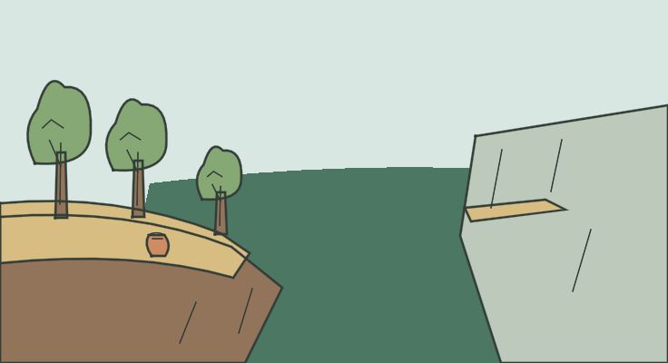

# LOC_CLIFF — Acantilado y cornisa opuesta

**IMPLEMENTED / TECHNICAL PASS / MANUAL_VALIDATION PENDING**

- Identidad canónica: `LOC_CLIFF`.
- Fuente: `godot/data/chapter_01_surface.json → locations.LOC_CLIFF`, contrastada con el YAML por el exportador; descripción original:

> The forest thins out here to reveal a steep cliff. There is no way down, but a small ledge can be seen to the west across the chasm.

- Elementos representados: Borde rocoso abrupto, bosque que se aclara, abismo, pequeña cornisa al otro lado y urna empotrada.
- Relaciones, estados y excepción de cámara: No hay descenso dibujado. Se muestra solo la silueta fija de URN, sin afirmar contenido o llama. La cornisa está al oeste según la fuente, no según el eje de pantalla.
- Referencia heredada conservada: `godot/data/art_ch01.json → scenes.LOC_CLIFF`.
- Recurso nuevo: `godot/data/vector_ch01/loc_cliff.json`; 27 trazos, 13 regiones; 736 × 400.
- Técnica: máscaras exactas respecto al raster Python, semillas interiores y regiones conectadas; sin celdas sin fondo. Playback completo y Omitir iguales píxel a píxel. Cancelación, revisita, selector runtime y TAB pasan. Los márgenes y la lectura final se inspeccionan visualmente; aceptación humana pendiente.
- Preparación gráfica: 2.161316 s. Dibujo: 3.501062 s. Las cifras corresponden al equipo de captura, no son garantías.

[Reproducción muestreada](../evidence/LOC_CLIFF/playback.gif) · [Dentro de la UI real](../evidence/LOC_CLIFF/runtime.png) · [Volver a la galería](../gallery.html)

GIF elaborado con frames reales, paleta/tiempos aproximados y pausa final añadida; no es prueba de FPS ni igualdad exacta. El PNG y las métricas conservan la evidencia gráfica completa. Los cambios de colocación para capturas son fixtures de prueba, no viajes añadidos al juego.
