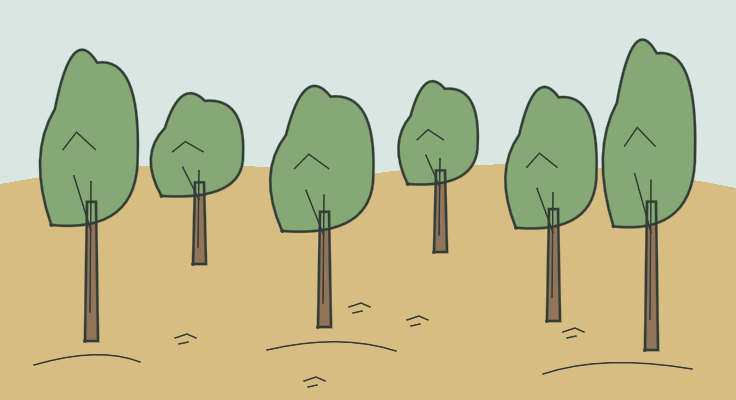

# LOC_FOREST — Bosque sin hitos

**IMPLEMENTED / TECHNICAL PASS / MANUAL_VALIDATION PENDING**

- Identidad canónica: `LOC_FOREST1` y los otros 21 IDs FOREST; alias de dibujo LOC_FOREST.
- Fuente: `godot/data/chapter_01_surface.json → locations.LOC_FOREST1`, contrastada con el YAML por el exportador; descripción original:

> You are wandering aimlessly through the forest.

- Elementos representados: Seis árboles de escala y profundidad distintas, hojarasca y suelo continuo.
- Relaciones, estados y excepción de cámara: Dibujo compartido por LOC_FOREST1…LOC_FOREST22; no es un nuevo ID de sala. No hay senda, flechas o hitos que resuelvan el bosque.
- Referencia heredada conservada: `godot/data/art_ch01.json → scenes.LOC_FOREST`.
- Recurso nuevo: `godot/data/vector_ch01/loc_forest.json`; 43 trazos, 14 regiones; 736 × 400.
- Técnica: máscaras exactas respecto al raster Python, semillas interiores y regiones conectadas; sin celdas sin fondo. Playback completo y Omitir iguales píxel a píxel. Cancelación, revisita, selector runtime y TAB pasan. Los márgenes y la lectura final se inspeccionan visualmente; aceptación humana pendiente.
- Preparación gráfica: 2.083880 s. Dibujo: 3.510644 s. Las cifras corresponden al equipo de captura, no son garantías.

[Reproducción muestreada](../evidence/LOC_FOREST/playback.gif) · [Dentro de la UI real](../evidence/LOC_FOREST/runtime.png) · [Volver a la galería](../gallery.html)

GIF elaborado con frames reales, paleta/tiempos aproximados y pausa final añadida; no es prueba de FPS ni igualdad exacta. El PNG y las métricas conservan la evidencia gráfica completa. Los cambios de colocación para capturas son fixtures de prueba, no viajes añadidos al juego.
