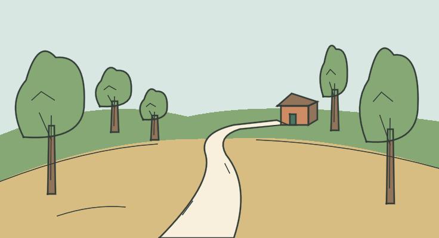

# LOC_HILL — Loma del camino

**IMPLEMENTED / TECHNICAL PASS / MANUAL_VALIDATION PENDING**

- Identidad canónica: `LOC_HILL`.
- Fuente: `godot/data/chapter_01_surface.json → locations.LOC_HILL`, contrastada con el YAML por el exportador; descripción original:

> You have walked up a hill, still in the forest. The road slopes back down the other side of the hill. There is a building in the distance.

- Elementos representados: Lomo del terreno, camino que baja al otro lado, bosque y casita lejana.
- Relaciones, estados y excepción de cámara: La casa conserva ladrillo/tejado de START a menor escala. No se añade humo, puente ni una conexión nueva.
- Referencia heredada conservada: `godot/data/art_ch01.json → scenes.LOC_HILL`.
- Recurso nuevo: `godot/data/vector_ch01/loc_hill.json`; 35 trazos, 18 regiones; 736 × 400.
- Técnica: máscaras exactas respecto al raster Python, semillas interiores y regiones conectadas; sin celdas sin fondo. Playback completo y Omitir iguales píxel a píxel. Cancelación, revisita, selector runtime y TAB pasan. Los márgenes y la lectura final se inspeccionan visualmente; aceptación humana pendiente.
- Preparación gráfica: 2.410165 s. Dibujo: 3.516730 s. Las cifras corresponden al equipo de captura, no son garantías.

[Reproducción muestreada](../evidence/LOC_HILL/playback.gif) · [Dentro de la UI real](../evidence/LOC_HILL/runtime.png) · [Volver a la galería](../gallery.html)

GIF elaborado con frames reales, paleta/tiempos aproximados y pausa final añadida; no es prueba de FPS ni igualdad exacta. El PNG y las métricas conservan la evidencia gráfica completa. Los cambios de colocación para capturas son fixtures de prueba, no viajes añadidos al juego.
