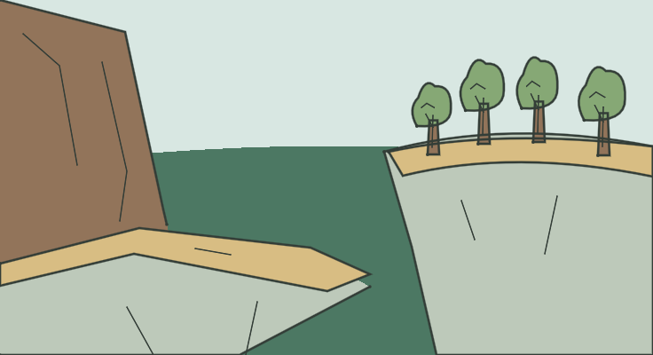

# LOC_LEDGE — Cornisa aislada

**IMPLEMENTED / TECHNICAL PASS / MANUAL_VALIDATION PENDING**

- Identidad canónica: `LOC_LEDGE`.
- Fuente: `godot/data/chapter_01_surface.json → locations.LOC_LEDGE`, contrastada con el YAML por el exportador; descripción original:

> You are on a small ledge on one face of a sheer cliff. There are no paths away from the ledge. Across the chasm is a small clearing surrounded by forest.

- Elementos representados: Repisa en primer plano y pared vertical; enfrente, un claro rodeado de bosque.
- Relaciones, estados y excepción de cámara: No se añade senda de salida. SAPPH es transportable y queda en la descripción real del terminal, no pintado permanentemente. La fuente no ofrece una entrada jugable nueva en este corte.
- Referencia heredada conservada: `godot/data/art_ch01.json → scenes.LOC_LEDGE`.
- Recurso nuevo: `godot/data/vector_ch01/loc_ledge.json`; 32 trazos, 15 regiones; 736 × 400.
- Técnica: máscaras exactas respecto al raster Python, semillas interiores y regiones conectadas; sin celdas sin fondo. Playback completo y Omitir iguales píxel a píxel. Cancelación, revisita, selector runtime y TAB pasan. Los márgenes y la lectura final se inspeccionan visualmente; aceptación humana pendiente.
- Preparación gráfica: 2.645944 s. Dibujo: 3.515618 s. Las cifras corresponden al equipo de captura, no son garantías.

[Reproducción muestreada](../evidence/LOC_LEDGE/playback.gif) · [Dentro de la UI real](../evidence/LOC_LEDGE/runtime.png) · [Volver a la galería](../gallery.html)

GIF elaborado con frames reales, paleta/tiempos aproximados y pausa final añadida; no es prueba de FPS ni igualdad exacta. El PNG y las métricas conservan la evidencia gráfica completa. Los cambios de colocación para capturas son fixtures de prueba, no viajes añadidos al juego.
