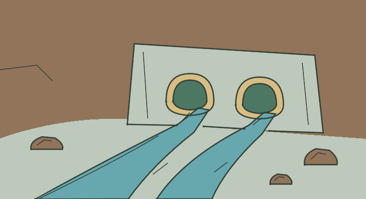

# LOC_SEWER — Dos tuberías de un pie

**IMPLEMENTED / TECHNICAL PASS / MANUAL_VALIDATION PENDING**

- Identidad canónica: `LOC_SEWER`.
- Fuente: `godot/data/chapter_01_surface.json → locations.LOC_SEWER`, contrastada con el YAML por el exportador; descripción original:

> The stream flows out through a pair of 1 foot diameter sewer pipes. It would be advisable to use the exit.

- Elementos representados: Par de bocas pequeñas en un muro amplio, cauces de agua y roca.
- Relaciones, estados y excepción de cámara: No se dibuja un túnel humano ni una salida nueva. DEEP y ausencia de LIT se conservan en datos: no se añade lámpara, fuego o lógica de iluminación.
- Referencia heredada conservada: `godot/data/art_ch01.json → scenes.LOC_SEWER`.
- Recurso nuevo: `godot/data/vector_ch01/loc_sewer.json`; 23 trazos, 13 regiones; 736 × 400.
- Técnica: máscaras exactas respecto al raster Python, semillas interiores y regiones conectadas; sin celdas sin fondo. Playback completo y Omitir iguales píxel a píxel. Cancelación, revisita, selector runtime y TAB pasan. Los márgenes y la lectura final se inspeccionan visualmente; aceptación humana pendiente.
- Preparación gráfica: 3.180843 s. Dibujo: 3.510946 s. Las cifras corresponden al equipo de captura, no son garantías.

[Reproducción muestreada](../evidence/LOC_SEWER/playback.gif) · [Dentro de la UI real](../evidence/LOC_SEWER/runtime.png) · [Volver a la galería](../gallery.html)

GIF elaborado con frames reales, paleta/tiempos aproximados y pausa final añadida; no es prueba de FPS ni igualdad exacta. El PNG y las métricas conservan la evidencia gráfica completa. Los cambios de colocación para capturas son fixtures de prueba, no viajes añadidos al juego.
