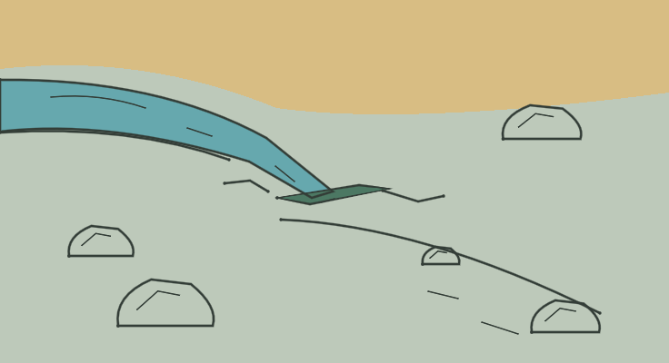

# LOC_SLIT — Ranura de dos pulgadas

**IMPLEMENTED / TECHNICAL PASS / MANUAL_VALIDATION PENDING**

- Identidad canónica: `LOC_SLIT`.
- Fuente: `godot/data/chapter_01_surface.json → locations.LOC_SLIT`, contrastada con el YAML por el exportador; descripción original:

> At your feet all the water of the stream splashes into a 2-inch slit in the rock. Downstream the streambed is bare rock.

- Elementos representados: Agua que converge en una grieta estrecha, roca desnuda aguas abajo y piedras para escala.
- Relaciones, estados y excepción de cámara: La abertura no es una puerta ni una cueva transitable; su ancho se expresa por un hueco delgado, sin inventar una escala métrica absoluta de cámara.
- Referencia heredada conservada: `godot/data/art_ch01.json → scenes.LOC_SLIT`.
- Recurso nuevo: `godot/data/vector_ch01/loc_slit.json`; 22 trazos, 10 regiones; 736 × 400.
- Técnica: máscaras exactas respecto al raster Python, semillas interiores y regiones conectadas; sin celdas sin fondo. Playback completo y Omitir iguales píxel a píxel. Cancelación, revisita, selector runtime y TAB pasan. Los márgenes y la lectura final se inspeccionan visualmente; aceptación humana pendiente.
- Preparación gráfica: 3.271284 s. Dibujo: 3.514113 s. Las cifras corresponden al equipo de captura, no son garantías.

[Reproducción muestreada](../evidence/LOC_SLIT/playback.gif) · [Dentro de la UI real](../evidence/LOC_SLIT/runtime.png) · [Volver a la galería](../gallery.html)

GIF elaborado con frames reales, paleta/tiempos aproximados y pausa final añadida; no es prueba de FPS ni igualdad exacta. El PNG y las métricas conservan la evidencia gráfica completa. Los cambios de colocación para capturas son fixtures de prueba, no viajes añadidos al juego.
